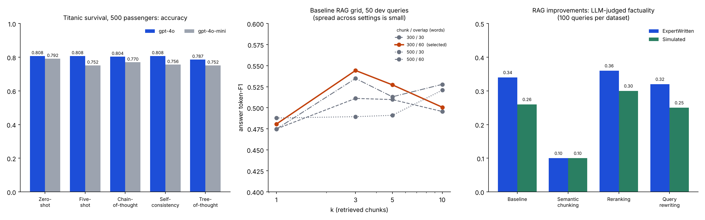
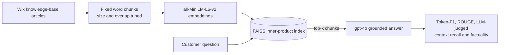

# LLM Prompting Strategies and Enterprise RAG on WixQA

Two experiments from one homework (DATA 266): **(1)** how much prompting strategy matters when an LLM predicts Titanic survival, and **(2)** a retrieval-augmented generation (RAG) pipeline over the Wix help-centre knowledge base, tuned and then tested with three add-ons.

> The numbers below are transcribed from the saved outputs of the Colab notebook in [`notebooks/`](notebooks/). The runs call the OpenAI API, so I did not re-run them for this repo. [`make_chart.py`](make_chart.py) redraws the chart from the CSVs in [`results/`](results/).

## 1. Prompting for tabular prediction (Titanic, 500 held-out passengers)

Each passenger row is rewritten as a plain-English description, and the model answers survived or not. Five strategies were run on two models, giving 10 conditions. Five labelled examples (3 survived, 2 not) come from a separate 391-passenger dev split, never from the test set.

| Strategy | gpt-4o acc | gpt-4o F1 | gpt-4o-mini acc | gpt-4o-mini F1 |
|---|---|---|---|---|
| Zero-shot | **0.808** | **0.759** | 0.792 | 0.723 |
| Five-shot | **0.808** | 0.742 | 0.752 | 0.663 |
| Chain-of-thought | 0.804 | 0.734 | 0.770 | 0.648 |
| Self-consistency | **0.808** | 0.741 | 0.756 | 0.661 |
| Tree-of-thought | 0.787 | 0.724 | 0.752 | 0.674 |

- **Zero-shot was the best or tied-best strategy for both models.** Adding examples or reasoning did not help, and the mini model got worse with every extra technique.
- **The extra prompting mostly traded recall for precision.** Chain-of-thought on gpt-4o-mini reached precision 0.841 but recall 0.527, so it called "did not survive" more often.
- **Ten passengers were misclassified by all 10 conditions.** Six are third-class men who survived, two are first-class men who died, one is a young girl who died, and one is a 63-year-old third-class woman who survived. All of them contradict the "women and first class survive" pattern the models rely on.

## 2. Enterprise RAG on WixQA

**Tuning the baseline.** 16 settings (chunk 300 or 500 words, overlap 30 or 60, k of 1, 3, 5 or 10) were scored on the first 50 WixQA-Synthetic queries with a composite of 0.4 × context recall + 0.3 × F1 + 0.3 × ROUGE-1. The winner was **300-word chunks, 60-word overlap, k = 3**, with F1 0.544 and ROUGE-1 0.621 (full grid in [`results/rag_hyperparameter_search.csv`](results/rag_hyperparameter_search.csv)).

**Baseline on the two evaluation sets (100 queries each, first run):**

| Dataset | Context recall | F1 | ROUGE-1 | ROUGE-2 | Factuality |
|---|---|---|---|---|---|
| WixQA-ExpertWritten | 0.99 | 0.258 | 0.283 | 0.174 | 0.34 |
| WixQA-Simulated | 0.89 | 0.174 | 0.206 | 0.109 | 0.27 |

**Three system improvements** (100 queries per dataset, k = 3):

| System | Expert recall | Expert factuality | Simulated recall | Simulated factuality |
|---|---|---|---|---|
| Baseline | 0.96 | 0.34 | 0.89 | 0.26 |
| + Semantic chunking (61,877 chunks vs 13,386) | 0.89 | 0.10 | 0.67 | 0.10 |
| **+ Cross-encoder reranking** (top 50 re-scored) | **1.00** | **0.36** | **0.97** | **0.30** |
| + Query rewriting | 0.96 | 0.32 | 0.88 | 0.25 |

- **Reranking was the only add-on that helped.** It lifted recall on both sets and factuality by two points (Expert) and four points (Simulated), with F1 roughly flat on Expert (0.263 to 0.264) and up on Simulated (0.173 to 0.189).
- **Semantic chunking hurt badly.** It produced 4.6 times more chunks, so each chunk is much smaller. I did not test why it hurt, but a fixed k of 3 over tiny chunks gives the generator very little context.
- **Query rewriting gave no gain.** It lowered F1 on both datasets.

## Caveats

- **The notebook header says GPT-4.1 and GPT-4o, but the code runs `gpt-4o` and `gpt-4o-mini`.** This README reports what was executed.
- **Most differences are small for the sample sizes.** With 500 passengers, 0.808 vs 0.804 is two passengers. With 100 RAG queries, a 0.04 factuality gap is four queries. Only the semantic-chunking drop and the gpt-4o vs gpt-4o-mini gap on few-shot and chain-of-thought are large. Nothing was repeated across seeds.
- **The tuning grid is weakly informative.** It used 50 queries, and context recall sat between 0.90 and 1.00 for every setting, so it barely separated them. F1 ranged only from 0.47 to 0.54.
- **The LLM judge is the same model as the generator.** Context recall and factuality are judged by `gpt-4o`, which also writes the answers, and the judge sees only a yes/no prompt. Treat those two metrics as a rough signal.
- **The baseline is not identical across runs.** The first run gave Expert recall 0.99 and F1 0.258, the comparison run 0.96 and 0.263. The comparison samples 100 queries with a fixed seed. The notebook does not say whether the first run used the same queries, so this may be sampling, nondeterministic generation or judge noise. It is a measure of how much the small differences above can be trusted.
- **F1 and ROUGE reward word overlap**, not correctness, so absolute values around 0.2 are normal for long free-text support answers.
- **Titanic context.** The test set is 299 "did not survive" and 201 "survived", so always answering "no" scores 0.598. All 10 conditions beat that. The 0.787 for gpt-4o with tree-of-thought is computed over its 492 valid answers.

## Stack

`Python` `OpenAI API` `FAISS` `sentence-transformers` `Hugging Face Datasets` `rouge-score` `scikit-learn` `pandas` `matplotlib`

## Notebooks

| Notebook | Contents |
|---|---|
| [`notebooks/DATA266_HW2_titanic_prompting_and_wixqa_rag.ipynb`](notebooks/DATA266_HW2_titanic_prompting_and_wixqa_rag.ipynb) | Full Colab run with outputs: both tasks, from data loading to the final summary. Colab account metadata removed. |
